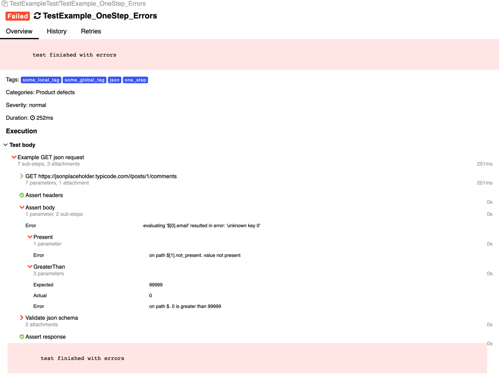
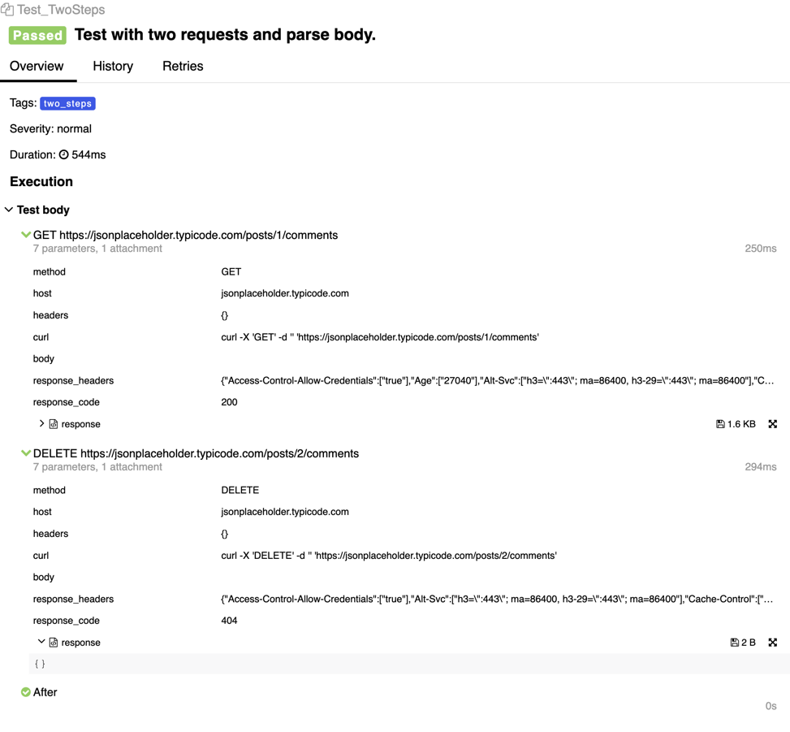
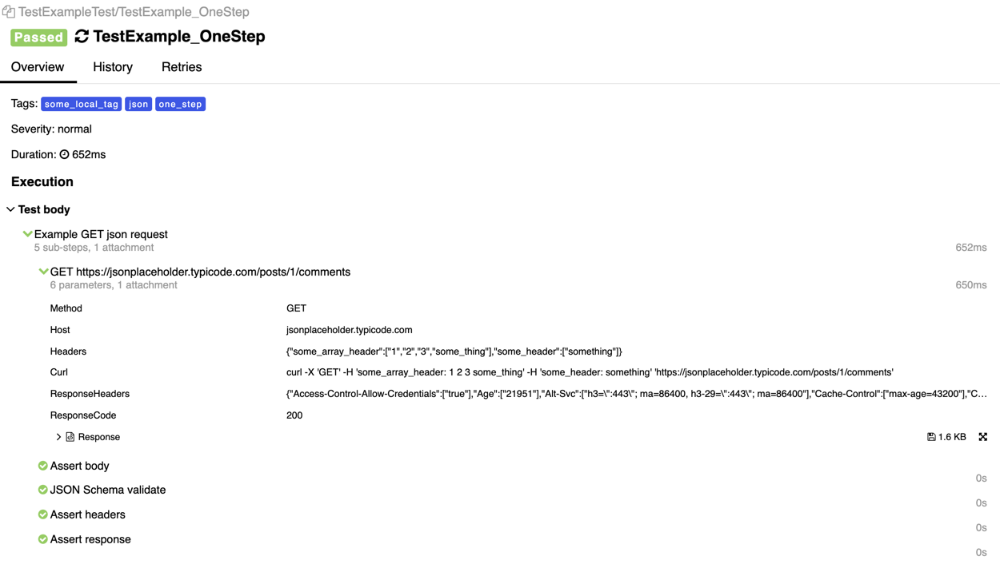
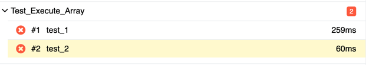
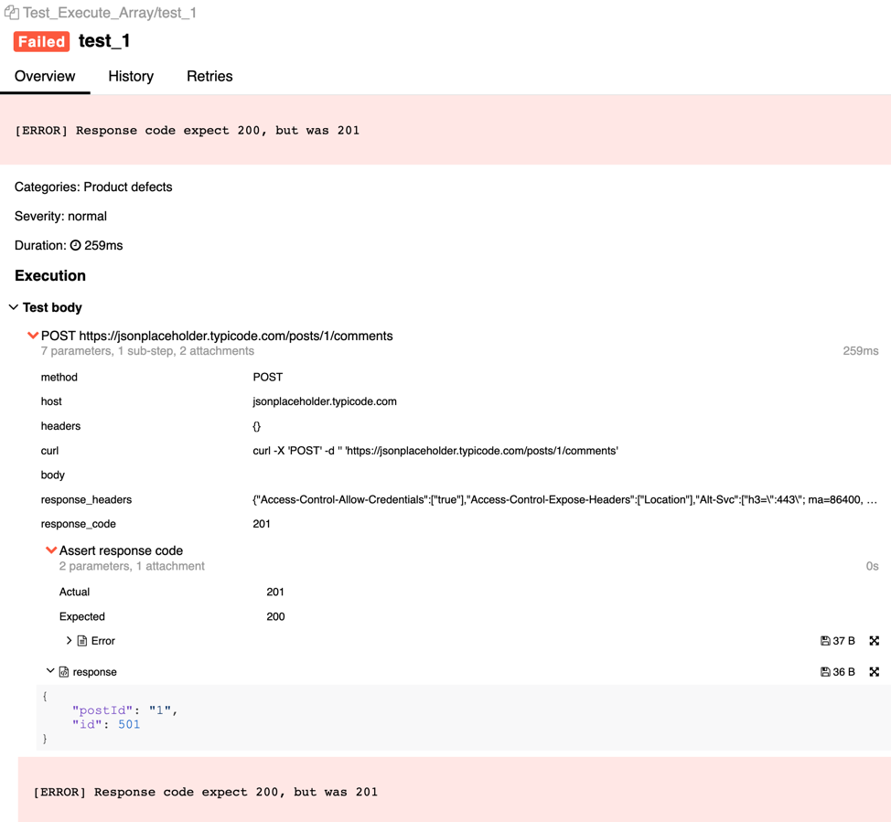
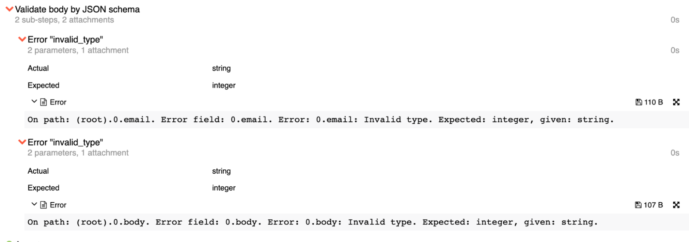
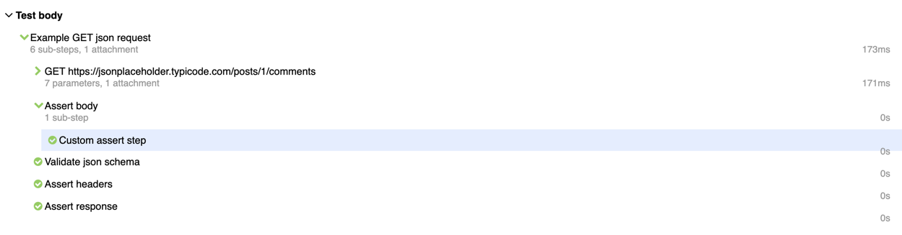
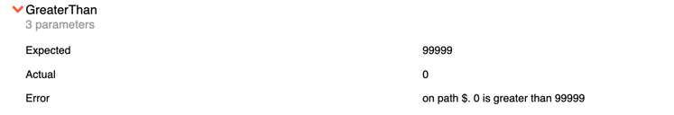
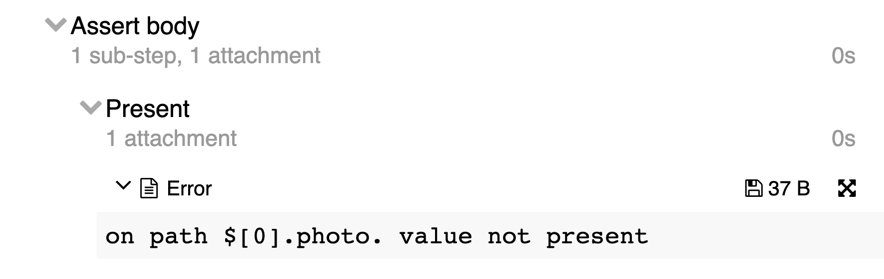

<p align="center">
  
</p>

# CUTE — create your tests easily

[English version](README.MD)

Библиотека для тестирования HTTP- и REST API на Go с отчётами Allure.

## Возможности

- Выразительный и понятный синтаксис.
- Встроенная поддержка JSON.
- Собственные проверки (asserts).
- Один шаг до BDD.
- Отчёты Allure.

---

## Содержание

- [Возможности](#возможности)
- [Порядок работы](#порядок-работы)
- [Установка](#установка)
- [Требования](#требования)
- [Демо](#демо)
- [Примеры тестов](#примеры-тестов)
    - [Одношаговый тест](#одношаговый-тест)
    - [Многошаговый тест](#многошаговый-тест)
    - [Тесты в наборе (suite)](#набор-тестов-suite)
    - [Табличные тесты](#табличные-тесты)
- [Проверки (asserts)](#проверки-asserts)
    - [Готовые проверки](#готовые-проверки)
        - [Проверки JSON](#проверки-json)
        - [Проверки заголовков](#проверки-заголовков)
        - [Валидация по JSON-схеме](#валидация-по-json-схеме)
    - [Собственные проверки](#собственные-проверки)
        - [Базовые типы](#базовые-типы)
        - [Типы с T](#типы-с-t)
        - [Ошибки проверок](#ошибки-проверок)
        - [Опциональные проверки](#опциональные-проверки)
- [Глобальные переменные окружения](#глобальные-переменные-окружения)


## Порядок работы
1. Создайте запрос и опишите проверки.
2. Запустите тесты.
3. Посмотрите отчёты Allure.

## Установка

```bash
  go get -u github.com/ozontech/cute
```

## Требования

- Go 1.17+


## Демо

Запустите пример.
```bash
  make example
```
Чтобы смотреть подробные отчёты, установите Allure. Это необязательно.

[Подробнее об отчётах Allure](https://github.com/allure-framework)

```bash
  brew install allure
```

Запустите Allure.

```bash
  allure serve ./examples/allure-results
```

## Примеры тестов

Готовые примеры лежат в каталоге [**examples**](examples).

### <h3><a href="examples/single_test.go">Одношаговый тест</a></h3>

Позволяет описать тест из одного запроса. Полный пример смотрите в каталоге [**examples**](examples).
Чтобы получить отчёт Allure, используйте `testing.T` или `provider.T` из [allure-go](https://github.com/ozontech/allure-go/tree/master?tab=readme-ov-file).

```go
import (
    "context"
    "net/http"
    "path"
    "testing"
    "time"

    "github.com/ozontech/cute"
    "github.com/ozontech/cute/asserts/json"
)

func TestExample(t *testing.T) {
    cute.NewTestBuilder().
        Title("Title").
        Description("some_description").
        Create().
        RequestBuilder(
            cute.WithURI("https://jsonplaceholder.typicode.com/posts/1/comments"),
            cute.WithMethod(http.MethodGet),
        ).
        ExpectExecuteTimeout(10*time.Second).
        ExpectStatus(http.StatusOK).
        AssertBody(
            json.Equal("$[0].email", "Eliseo@gardner.biz"),
            json.Present("$[1].name"),
        ).
        ExecuteTest(context.Background(), t)
}
```
<details>
  <summary>Отчёт Allure</summary>



</details>


### <h3><a href="examples/two_step_test.go">Многошаговый тест</a></h3>

Позволяет выполнить несколько запросов в одном тесте.

```go
import (
    "context"
    "fmt"
    "net/http"
    "testing"

    "github.com/ozontech/cute"
)
    
func Test_TwoSteps(t *testing.T) {
    responseCode := 0

    // First step
    cute.NewTestBuilder().
        Title("Test with two requests and parse body.").
        Tag("two_steps").
        Create().
        RequestBuilder(
            cute.WithURI("https://jsonplaceholder.typicode.com/posts/1/comments"),
            cute.WithMethod(http.MethodGet),
        ).
        ExpectStatus(http.StatusOK).
        NextTest().

        // Execute after first step and parse response code
        AfterTestExecute(func(response *http.Response, errors []error) error { 
            responseCode = response.StatusCode

            return nil
        }).

        // Second step
        Create().
        RequestBuilder(
            cute.WithURI("https://jsonplaceholder.typicode.com/posts/2/comments"),
            cute.WithMethod(http.MethodDelete),
        ).
        ExecuteTest(context.Background(), t)

        fmt.Println("Response code from first request", responseCode)
}
```
Полный пример смотрите в каталоге [**examples**](examples/two_step_test.go).

<details>
  <summary>Отчёт Allure</summary>



</details>

### <h3><a href="examples/suite">Набор тестов (suite)</a></h3>

Suite задаёт структуру для описания тестов: тесты группируются в наборы. Это удобно, когда тестов много и без дополнительного уровня вложенности по ним трудно ориентироваться.

[Подробнее о suite и отчётах Allure](https://github.com/ozontech/allure-go#suite)


1. Объявите структуру со встроенными `suite.Suite` и `*cute.HTTPTestMaker`.

```go
import (
    "github.com/ozontech/cute"
    "github.com/ozontech/allure-go/pkg/framework/provider"
    "github.com/ozontech/allure-go/pkg/framework/suite"
)

type ExampleSuite struct {
    suite.Suite
    host *url.URL

    testMaker *cute.HTTPTestMaker
}

func (i *ExampleSuite) BeforeAll(t provider.T) {
    // Prepare http test builder
    i.testMaker = cute.NewHTTPTestMaker()

    // Preparing host
    host, err := url.Parse("https://jsonplaceholder.typicode.com/")
    if err != nil {
        t.Fatalf("could not parse url, error %w", err)
    }

    i.host = host
}

```
2. Объявите тест.

```go
import (
    "github.com/ozontech/allure-go/pkg/framework/suite"
)

func TestExampleTest(t *testing.T) {
    suite.RunSuite(t, new(ExampleSuite))
}
```

3. Опишите тесты.

```go
import (
    "github.com/ozontech/cute"
    "github.com/ozontech/cute/asserts/headers"
    "github.com/ozontech/cute/asserts/json"
)

func (i *ExampleSuite) TestExample_OneStep(t provider.T) {
    var (
        testBuilder = i.testMaker.NewTestBuilder()
    )
    
    u, _ := url.Parse(i.host.String())
    u.Path = path.Join(u.Path, "/posts/1/comments")
    
    testBuilder.
        Title("TestExample_OneStep").
        Tags("one_step", "some_local_tag", "json").
        Create().
        StepName("Example GET json request").
        RequestBuilder(
            cute.WithHeaders(map[string][]string{
                "some_header":       []string{"something"},
                "some_array_header": []string{"1", "2", "3", "some_thing"},
            }),
            cute.WithURL(u),
            cute.WithMethod(http.MethodGet),
        ).
        ExpectExecuteTimeout(10*time.Second).
        ExpectJSONSchemaFile("file://./resources/example_valid_request.json").
        ExpectStatus(http.StatusOK).
        AssertBody(
            json.Equal("$[0].email", "Eliseo@gardner.biz"),
            json.Present("$[1].name"),
            json.NotPresent("$[1].some_not_present"),
            json.GreaterThan("$", 3),
            json.Length("$", 5),
            json.LessThan("$", 100),
            json.NotEqual("$[3].name", "kekekekeke"),
        ).
        OptionalAssertBody(
            json.GreaterThan("$", 3),
            json.Length("$", 5),
            json.LessThan("$", 100),
        ).
        AssertHeaders(
            headers.Present("Content-Type"),
        ).
        ExecuteTest(context.Background(), t)
}
```
Полный пример смотрите в каталоге [**examples**](examples/suite).

<details>
  <summary>Отчёт Allure</summary>



</details>

## <h2><a href="examples/table_test/table_test.go">Табличные тесты</a></h2>

Табличный тест можно создать двумя способами. Отчёты Allure при этом одинаковые.

### Табличные тесты через билдер

```go
import (
    "context"
    "fmt"
    "net/http"
    "testing"

    "github.com/ozontech/cute"
)

func Test_Table_Array(t *testing.T) {
    tests := []*cute.Test{
        {
            Name:       "test_1",
            Middleware: nil,
            Request: &cute.Request{
                Builders: []cute.RequestBuilder{
                    cute.WithURI("https://jsonplaceholder.typicode.com/posts/1/comments"),
                    cute.WithMethod(http.MethodPost),
                },
            },
            Expect: &cute.Expect{
                Code: 200,
            },
        },
        {
            Name:       "test_2",
            Middleware: nil,
            Request: &cute.Request{
                Builders: []cute.RequestBuilder{
                    cute.WithURI("https://jsonplaceholder.typicode.com/posts/1/comments"),
                    cute.WithMethod(http.MethodGet),
                },
            },
            Expect: &cute.Expect{
                Code: 200,
                AssertBody: []cute.AssertBody{
                    json.Equal("$[0].email", "Eliseo@gardner.biz"),
                    json.Present("$[1].name"),
                    func(body []byte) error {
                        return errors.NewAssertError("example error", "example message", nil, nil)
                    },
                },
            },
        },
    }

    cute.NewTestBuilder().
        Title("Example table test").
        Tag("table_test").
        Description("Execute array tests").
        CreateTableTest().
        PutTests(tests...).
        ExecuteTest(context.Background(), t)
}
```

### Массив тестов

```go
func Test_Execute_Array(t *testing.T) {
    tests := []*cute.Test{
        {
            Name:       "test_1",
            Middleware: nil,
            Request: &cute.Request{
                Builders: []cute.RequestBuilder{
                    cute.WithURI("https://jsonplaceholder.typicode.com/posts/1/comments"),
                    cute.WithMethod(http.MethodPost),
                },
            },
            Expect: &cute.Expect{
                Code: 200,
            },
        },
        {
            Name:       "test_2",
            Middleware: nil,
            Request: &cute.Request{
                Builders: []cute.RequestBuilder{
                    cute.WithURI("https://jsonplaceholder.typicode.com/posts/1/comments"),
                    cute.WithMethod(http.MethodGet),
                },
            },
            Expect: &cute.Expect{
                Code: 200,
                AssertBody: []cute.AssertBody{
                    json.Equal("$[0].email", "Eliseo@gardner.biz"),
                    json.Present("$[1].name"),
                    func(body []byte) error {
                        return errors.NewAssertError("example error", "example message", nil, nil)
                    },
                },
            },
        },
    }

    for _, test := range tests {
        test.Execute(context.Background(), t)
    }
}
```

Полный пример смотрите в каталоге [**examples**](examples/table_test/table_test.go).

<details>
  <summary>Отчёт Allure</summary>

Общий отчёт по всем табличным тестам:



Основной отчёт:



</details>

<h2><a href="asserts">Проверки (asserts)</a></h2>

Можно написать собственные проверки или взять готовые из пакета asserts.

### Готовые проверки

#### <h4><a href="asserts/json">Проверки JSON</a></h4>


- `Equal` — значение по выражению JSONPath равно заданному.
- `NotEqual` — значение по выражению JSONPath не равно заданному.
- `Length` — длина значения равна ожидаемой.
    - `GreaterThan` — длина значения больше заданной.
    - `GreaterOrEqualThan` — длина значения больше или равна заданной.
    - `LessThan` — длина значения меньше заданной.
    - `LessOrEqualThan` — длина значения меньше или равна заданной.
- `Present` — значение присутствует. Оно может быть равно 0 или null.
- `NotEmpty` — значение присутствует и не пустое. Оно не может быть равно 0 или null.
- `NotPresent` — значение отсутствует.
- `Diff` — сравнение двух JSON.
- `Contains` — выражение JSONPath извлекает значение, входящее в массив.
- `EqualJSON` — значение по выражению JSONPath равно заданному JSON.
- `NotEqualJSON` — значение по выражению JSONPath не равно заданному JSON.
- `GetValueFromJSON` — получение значения из JSON.

[Подробнее о выражениях JSONPath](https://goessner.net/articles/JsonPath/)

[Реализация проверок](https://github.com/ozontech/cute/blob/master/asserts/json/json.go)

#### <h4><a href="asserts/headers">Проверки заголовков</a></h4>

- `Present` — заголовок присутствует.
- `NotPresent` — заголовок отсутствует.

[Реализация проверок](asserts/headers/headers.go)

#### <h4><a href="jsonschema.go">Валидация по JSON-схеме</a></h4>

JSON-схему можно проверять тремя способами. Выбирайте способ по тому, где лежит схема.

- `ExpectJSONSchemaString(string)` — схема передаётся строкой.
- `ExpectJSONSchemaByte([]byte)` — схема передаётся массивом байт.
- `ExpectJSONSchemaFile(string)` — схема берётся из файла или с удалённого ресурса.

<details>
  <summary>Отчёт Allure</summary>



</details>

### <h3><a href="assert.go">Собственные проверки</a></h3>

Доступны [3 вида проверок](assert.go):

#### Базовые типы

Типы для создания собственных проверок.

```go
    type AssertBody func(body []byte) error
    type AssertHeaders func(headers http.Header) error
    type AssertResponse func(response *http.Response) error
```

Пример:

```go
func customAssertBody() cute.AssertBody {
    return func(bytes []byte) error {
        if len(bytes) == 0 {
            return errors.New("response body is empty")
        }
        
        return nil
    }
}
```

#### Типы с T

Нужны для собственных проверок, которые работают через [Allure Actions](https://github.com/ozontech/allure-go#suite) и [testing.TB](https://pkg.go.dev/testing#TB).
Внутри такой проверки можно:

- писать информацию в Allure;
- самостоятельно фиксировать ошибку в Allure;
- возвращать ошибку.

```go
    type AssertBodyT func(t cute.T, body []byte) error
    type AssertHeadersT func(t cute.T, headers http.Header) error
    type AssertResponseT func(t cute.T, response *http.Response) error
```

Пример с T:

```go
func customAssertBodyT() cute.AssertBodyT {
    return func(t cute.T, bytes []byte) error {
        require.GreaterOrEqual(t, len(bytes), 100)
        return nil
    }
}
```

Пример с созданием шагов:

```go
func customAssertBodySuite() cute.AssertBodyT {
    return func(t cute.T, bytes []byte) error {
        step := allure.NewSimpleStep("Custom assert step")
        defer func() {
            t.Step(step)
        }()

        if len(bytes) == 0 {
            step.Status = allure.Failed
            step.Attachment(allure.NewAttachment("Error", allure.Text, []byte("response body is empty")))

            return nil
        }

        return nil
    }
}

```

<details>
  <summary>Отчёт Allure</summary>



</details>

#### <h4><a href="errors/error.go">Ошибки проверок</a></h4>

Можно использовать метод `errors.NewAssertError` из пакета [errors](errors/error.go).

Пример:

```go
import (
    "github.com/ozontech/cute"
    "github.com/ozontech/cute/errors"
)

func customAssertBodyWithCustomError() cute.AssertBody {
    return func(bytes []byte) error {
        if len(bytes) == 0 {
            return errors.NewAssertError("customAssertBodyWithCustomError", "body must be not empty", "len is 0", "len more 0")
        }

        return nil
    }
}
```
Чтобы в собственной проверке получить аккуратную ошибку, реализуйте [интерфейсы](errors/error.go):

- имя;

```go
type WithNameError interface {
    GetName() string
    SetName(string)
}
```

- параметры шага Allure.

```go
type WithFields interface {
    GetFields() map[string]interface{}
    PutFields(map[string]interface{})
}
```

<details>
  <summary>Отчёт Allure</summary>



</details>

#### Опциональные проверки

Если проверка возвращает опциональную ошибку, шаг помечается как неуспешный, но тест проходит.

Используйте метод `errors.NewOptionalError(error)` из пакета [errors](errors/error.go).

```go
import (
    "github.com/ozontech/cute"
    "github.com/ozontech/cute/errors"
)

func customAssertBodyWithCustomError() cute.AssertBody {
    return func(bytes []byte) error {
        if len(bytes) == 0 {
            return errors.NewOptionalError("body is empty")
        }

        return nil
    }
}
```

Чтобы сделать ошибку опциональной, реализуйте интерфейс:

```go
type OptionalError interface {
    IsOptional() bool
    SetOptional(bool)
}
```

<details>
  <summary>Отчёт Allure</summary>



</details>

## <h2><a href="https://github.com/ozontech/allure-go?tab=readme-ov-file#wrench-configure-your-environment">Глобальные переменные окружения</a></h2>


| Ключ | Назначение                                                                  | По умолчанию             |
|---|-----------------------------------------------------------------------------|--------------------------|
|`ALLURE_OUTPUT_PATH`| Путь для результатов Allure.                                                | `.` (каталог с тестами)  |
|`ALLURE_OUTPUT_FOLDER`| Имя каталога с результатами.                                                | `/allure-results`        |
|`ALLURE_ISSUE_PATTERN`| Шаблон URL задачи. Должен содержать `%s`.                                   |                          |
|`ALLURE_TESTCASE_PATTERN`| Шаблон URL тест-кейса. Должен содержать `%s`.                               |                          |
|`ALLURE_LAUNCH_TAGS`| Теги по умолчанию для всех тестов. Теги разделяются запятыми.               |                          |
